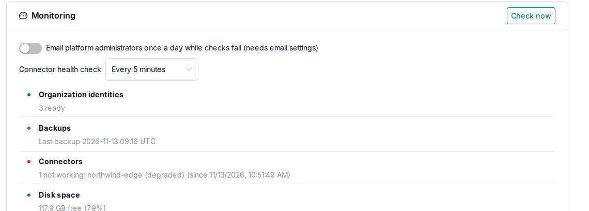

# Operations

## Everyday commands

```bash
bash manage.sh health            # API, database and backend status
bash manage.sh status            # containers and connectors
bash manage.sh rebuild backend   # rebuild and restart after an update
bash manage.sh rebuild frontend
bash manage.sh logs backend
bash manage.sh                   # lists every command
```

Under **Platform Admin → Operations**, administrators can check identity services, connectors,
storage and certificates. Email alerts are sent once monitoring and email are configured.



## Backups

Backups are encrypted with `BACKUP_PASSPHRASE` from `.env`. The passphrase is generated on first
use. Also keep a copy of it somewhere other than the server. Daily backups, retention, backups on demand
and downloads are configured under **Platform Admin → Operations**.

| Included in a platform backup                                   | Not included                                         |
| --------------------------------------------------------------- | ---------------------------------------------------- |
| The platform database and uploaded contracts                    | Connector databases, Vaults and runtime volumes      |
| The PostgreSQL and Vault state of the identity services         | Source data                                          |
| `.env` and the platform configuration files                     | A production identity on a separate identity host    |

Connector data is saved separately with **Export connector data** on each connector. The export
contains the definitions and exchange history, but no secrets or source files.

| Command                                   | Effect                                                                                                         |
| ----------------------------------------- | -------------------------------------------------------------------------------------------------------------- |
| `bash manage.sh backup create`            | Writes an encrypted backup                                                                                     |
| `bash manage.sh backup verify <file>`     | Test-restores the backup in temporary containers and checks its contents                                       |
| `bash manage.sh backup restore <file>`    | Replaces the platform state of this installation with the backup, after confirmation (`OPENDS_RESTORE_CONFIRM=yes` without a terminal) |

To restore on a new server, install OpenDS first, then restore with the original passphrase:
`BACKUP_PASSPHRASE=<passphrase> bash manage.sh backup restore <file>`. Platform-hosted connectors on the same server keep their runtime data.
On a new server, they must be provisioned again, with their definitions imported and their
credentials entered again. A production identity on a separate identity host is recovered as
described under
[Identity services](/administration/identity-services#rebuilding-a-lost-identity-host).

The database and the contract files are copied one after the other. If you need a fully
consistent recovery point, pause contract uploads and deletions while taking a backup.

## Self-hosted connectors

Organizations install, run and move their self-hosted connectors themselves, as described under
[Self-hosted connector](/self-hosting/self-hosted-connector). As an operator, note:

- **Installer links**: a link downloads setup files with identity credentials and enrolls one
  agent. After that, it no longer works. A new installer, **Reinstall** or a rotated STS secret
  invalidates earlier unused links. Make sure that reverse proxies and monitoring services in front
  of OpenDS, and shell histories, do not record these links.
- **Running state**: a self-hosted connector only counts as running when all its services are
  healthy, not merely when its agent is online.
- **Deletion**: deleting the platform record of an offline connector cannot erase the remote
  machine.

## Platform secrets

Setup generates two secrets in `.env`, which are included in backups.

- **`PAYLOAD_SECRET`**: signs sessions and API keys. If it may have leaked, set a new value of at
  least 32 characters in `.env` and run `docker compose up -d backend worker`. Everyone then
  signs in again, and API keys must be created again. Connectors and stored data are not
  affected.
- **`OPENDS_DATA_KEY`**: protects the connector and identity secrets and the SMTP password.
  It must never be changed, because existing connectors and identities would stop working.
