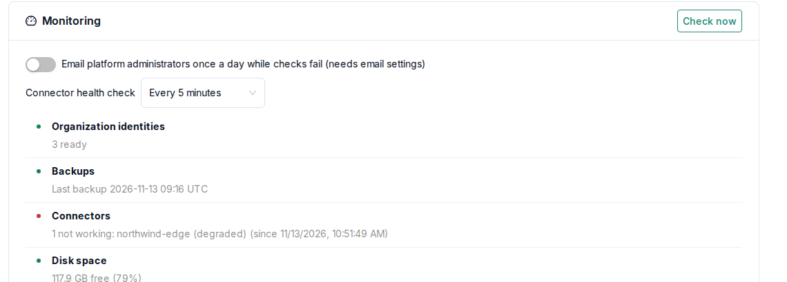

# Operations

## Everyday commands

Run these commands from the OpenDS installation directory:

```bash
bash manage.sh health            # API, database and backend status
bash manage.sh status            # containers and connectors
bash manage.sh rebuild backend   # rebuild and restart after code changes
bash manage.sh rebuild frontend
bash manage.sh logs backend
bash manage.sh                   # lists every command
```

Under **Platform Admin → Operations**, administrators can monitor identity services, connectors,
storage and certificates. Email alerts are sent once monitoring and email are configured.



## Backups

Backups are encrypted using `BACKUP_PASSPHRASE` from `.env`. The passphrase is generated on
first use. Keep a separate copy somewhere other than the server.

Configure daily backups, retention, on-demand backups and downloads under **Platform Admin →
Operations**. The backup service checks for scheduled and requested backups every ten minutes,
so a backup started with **Back up now** may take a few minutes to appear in the list.

| Included in a platform backup                                   | Not included                                         |
| --------------------------------------------------------------- | ---------------------------------------------------- |
| The platform database and uploaded contracts                    | Connector databases, Vaults and runtime volumes      |
| The PostgreSQL and Vault state of the identity services         | Source data                                          |
| `.env` and the platform configuration files                     |                                                      |
| The database and Vault of a linked separate identity host       |                                                      |

Connector data is saved separately with **Export connector data** on each connector. The export
contains the products, policies, offers and exchange history, but no secrets or source files.

The database and the contract files are copied one after the other. If you need a fully
consistent recovery point, pause contract uploads and deletions while taking a backup.

| Command                                   | Effect                                                                                                         |
| ----------------------------------------- | -------------------------------------------------------------------------------------------------------------- |
| `bash manage.sh backup create`            | Writes an encrypted backup to `backups/` in the OpenDS folder, readable only by its owner. Set `OPENDS_BACKUP_DIR` to use a different location |
| `bash manage.sh backup verify <file>`     | Restores the backup in temporary containers and checks its contents                                            |
| `bash manage.sh backup restore <file>`    | Replaces the platform state of this installation with the backup, after confirmation. For non-interactive use, set `OPENDS_RESTORE_CONFIRM=yes` |

To restore a backup, provide the original passphrase:

```bash
BACKUP_PASSPHRASE=<passphrase> bash manage.sh backup restore <file>
```

On a new server, install OpenDS before restoring the backup.

- **Platform-hosted connectors**: on the same server, connectors retain their runtime data. On
  a new server, they must be provisioned again. Import their products, policies and offers, and
  enter their credentials again.
- **Separate identity host**: `backup restore` does not restore its data. The backup retains
  that data for manual recovery only. The supported recovery procedure is to rebuild the host,
  as described under
  [Identity services](/administration/identity-services#rebuilding-a-lost-identity-host).

## Self-hosted connectors

Organizations install, run and move their self-hosted connectors themselves, as described under
[Self-hosted connector](/self-hosting/self-hosted-connector). As an operator, note:

- **Installer links**: a link downloads setup files with identity credentials and enrolls one
  agent. After that, it no longer works. A new installer, **Reinstall** or a rotated STS secret
  invalidates earlier unused links. Make sure that reverse proxies and monitoring services in front
  of OpenDS, and shell histories, do not record these links.
- **Running state**: a self-hosted connector only counts as running when all its services are
  healthy, not merely when its agent is online.
- **Deletion**: deleting the platform record of an offline connector does not erase the
  connector from the remote server.

## Platform secrets

Setup generates two secrets in `.env`, both of which are included in backups.

- **`PAYLOAD_SECRET`**: signs sessions and API keys. If it may have been exposed, replace it with a
  new value of at least 32 characters in `.env`, then run `docker compose up -d backend worker`.
  All users must sign in again, and API keys must be recreated. Connectors and stored data are not
  affected.
- **`OPENDS_DATA_KEY`**: protects connector and identity secrets, as well as the SMTP
  password. Never change this value, because doing so would prevent existing connectors and
  identities from working.
