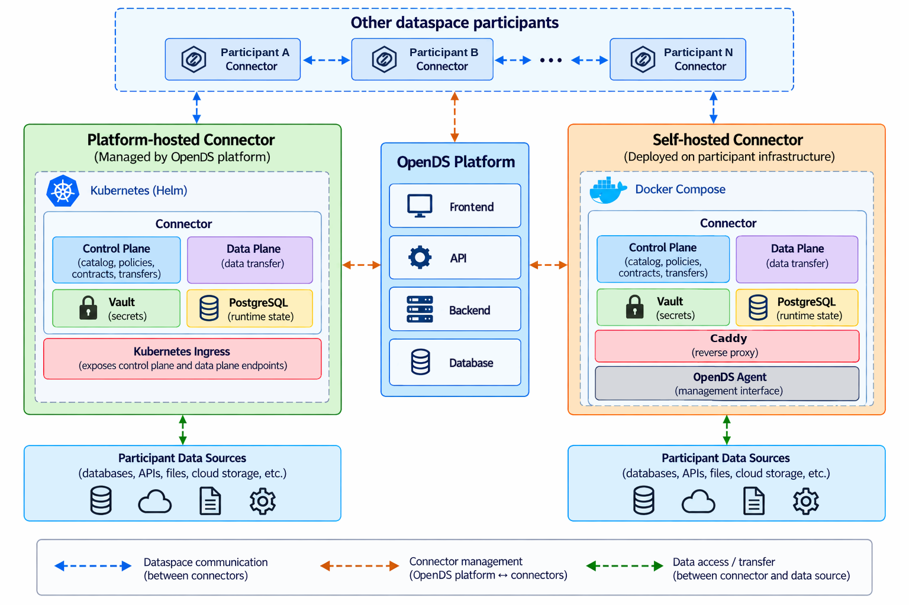

# Architecture

OpenDS centrally manages the dataspace infrastructure, including connector deployments,
identities and data exchange workflows. Data is exchanged directly between the connectors of
the participating organizations. Connectors can either be hosted by the platform on Kubernetes
or self-hosted on a participant's infrastructure and managed through the OpenDS agent.

## Components

| Part              | Description                                                                                                   |
| ----------------- | ------------------------------------------------------------------------------------------------------------- |
| Frontend          | The web application, built with React, Ant Design and TanStack Query                                          |
| Backend           | Payload 3 on Next.js, which provides the REST API, authentication and permissions                             |
| Worker            | Runs queued jobs such as connector provisioning, identity tasks, health checks and notifications              |
| PostgreSQL        | Stores users, organizations, permissions, approvals and operational records                                   |
| Connectors        | Official Tractus-X EDC runtime, each with its own control plane, data plane, PostgreSQL and Vault             |
| Identity services | Tractus-X IdentityHub, IssuerService and BDRS, as described in [Identity services](/administration/identity-services) |

The backend enforces all permissions. The browser does not access connector Vaults, Kubernetes
or connector Management APIs directly. The backend and worker run without root privileges or
Linux capabilities. Connector pods are not assigned Kubernetes API tokens.

## Data storage and ownership

- **Platform database**: users, organizations, memberships, permissions, approval workflows,
  audit entries and operational records.
- **Connectors**: data products, policies, offers, source configurations, negotiations,
  agreements and transfers. OpenDS reads this information directly from the connectors
  without maintaining copies.
- **Connector Vaults**: source credentials and connector secrets. For self-hosted connectors,
  credentials are entered and stored on the organization's own host.
- **Not stored by OpenDS**: EDR access tokens (short-lived tokens used for pull transfers),
  dataset bytes, and self-hosted Management API request and response bodies. Self-hosted EDR
  responses are held in backend memory only and discarded after delivery. Downloads are
  handled directly through the connector's data plane.

## Connector hosting

Both hosting modes use the same connector runtime:

- **Platform-hosted**: OpenDS manages connectors on Kubernetes, either in the local cluster
  created during setup or in a [separate cluster](/administration/remote-connector-cluster).
- **Self-hosted**: the organization runs the connector using Docker Compose on its own server.
  A lightweight agent polls OpenDS for queued operations and executes them locally. OpenDS
  therefore requires no inbound access to the connector's Management API. See
  [Self-hosted connector](/self-hosting/self-hosted-connector).

Each platform-hosted connector runs in its own Kubernetes namespace with a network policy. The
policy allows its pods to communicate within that namespace, access cluster DNS and ingress,
and reach external addresses. It blocks communication with pods in other connector namespaces
and prevents access to cloud infrastructure metadata services.

The policy is applied during provisioning and requires a Kubernetes network implementation
that enforces NetworkPolicy. The local cluster provides this capability, and a remote cluster
must provide it as well.

## Connector runtime

OpenDS uses the Tractus-X EDC 0.13.0 distribution as its connector runtime. The upstream
container images and Helm chart are used without modifications. Runtime-specific settings,
including image versions, API version, endpoints and chart checksum, are maintained in
`runtimes/tractusx/profile.json`.

OpenDS handles connector deployment and configuration and integrates with the runtime through
its Management API and policy adapters. It does not modify the EDC Java implementation,
implement the Dataspace Protocol (DSP) or the Decentralized Claims Protocol (DCP) itself, or
maintain a connector fork.

## Identity

Each organization has one DID and one BPN, shared by all its connectors. The DID serves as the
primary protocol identity for DCP 1.0 and DSP 2025-1. The BPN and BDRS directory are also
required by the Tractus-X runtime and are handled within the Tractus-X adapter.

OpenDS allocates BPNs within its own dataspace. Identity types are described under
[Identity](/user-guide/identity), and where the identity services run under
[Identity services](/administration/identity-services).

## Policy enforcement

When an offer is published, OpenDS translates each policy term into a constraint supported by
the Tractus-X policy engine. Terms that the connector can evaluate are enforced during
negotiations and transfers. Contractual terms are recorded in the agreement but cannot be
technically enforced once the data has been received.

| Policy term                             | Enforced by | How                                                              |
| --------------------------------------- | ----------- | ---------------------------------------------------------------- |
| Verified participants                   | Connector   | Checks the consumer's membership credential                      |
| Allowed organizations                   | Connector   | Checks that the consumer is one of the allowed organizations     |
| Partner group                           | Connector   | Checks that the consumer is a member of the group                |
| Time limit                              | Connector   | Refuses transfers once the agreement has expired                 |
| Usage purpose                           | Contract    | Recorded in the agreement                                        |
| Contract reference and document         | Contract    | Recorded in the agreement, with a checksum of the contract PDF   |
| Jurisdictions, onward sharing, deletion | Contract    | Recorded in the agreement                                        |
