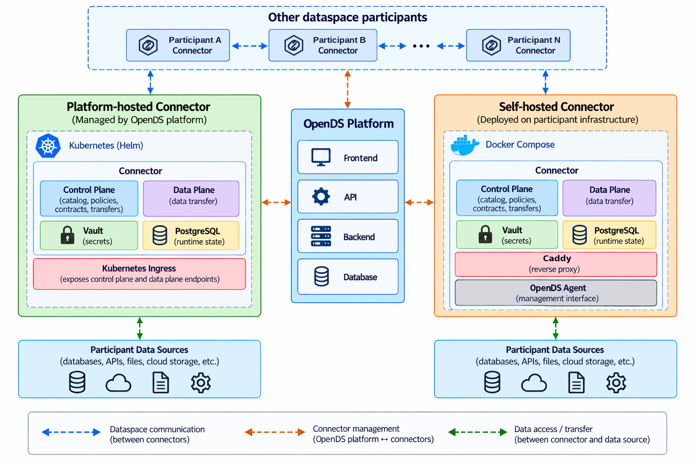

# Architecture

OpenDS manages the dataspace infrastructure and coordinates connector operations. Data
exchange is performed by the connectors of the participating organizations, while OpenDS
provides centralized management of connector deployments, identities and data exchange
workflows. Connectors are either hosted by the platform on Kubernetes or self-hosted on a
participant's own infrastructure and controlled through the OpenDS agent.



## Components

| Part              | Description                                                                                                   |
| ----------------- | ------------------------------------------------------------------------------------------------------------- |
| Frontend          | The web application, built with React, Ant Design and TanStack Query                                          |
| Backend           | Payload 3 on Next.js, which provides the REST API, authentication, permissions and business rules             |
| Worker            | Runs queued jobs such as connector provisioning, identity tasks, health checks and notifications              |
| PostgreSQL        | Stores users, organizations, permissions, approvals and operational records                                   |
| Connectors        | Official, unmodified Tractus-X EDC 0.13, each with its own control plane, data plane, PostgreSQL and Vault    |
| Identity services | Tractus-X IdentityHub, IssuerService and BDRS, as described in [Identity services](/identity/identity-hosting) |

The backend owns every permission and business rule, so the browser never communicates with
Vault, Kubernetes or a connector's management API directly. Backend and worker run without
root rights or Linux capabilities, and connector pods receive no Kubernetes API token.

## Where data lives

- **Platform database**: users, organizations, memberships, permissions, approval
  workflows, audit entries and operational records.
- **Connectors**: products, policies, offers, source configuration, negotiations,
  agreements and transfers. OpenDS reads them live and keeps no copies.
- **Connector Vaults**: source credentials and connector secrets. Self-hosted credentials
  are entered on the connector's own host.
- **Never stored**: access tokens (EDRs), dataset bytes, and self-hosted Management API
  request and response bodies. Self-host EDR responses pass through backend memory and are
  discarded after delivery, which assumes one backend instance. Downloads go directly
  through the connector's data plane.

Connector Vaults keep their data across restarts and unseal themselves; see
[Development](/development#internals) for how.

## Connector hosting

The connector runtime and its hosting are independent of each other. A platform-hosted
connector is managed by OpenDS on Kubernetes, either in the local cluster created by setup or
in a [separate cluster](/administration/remote-cluster). A self-hosted connector runs with
Docker Compose on the organization's own server, where a small agent polls OpenDS for queued
operations and runs them locally. OpenDS therefore never needs inbound access to the management
API of a self-hosted connector, as described in
[Self-hosted connector](/guide/self-hosted-connector).

Each platform-hosted connector runs in its own namespace with a network policy. Its pods can
reach their own namespace, the cluster's DNS and ingress, and addresses outside the cluster,
while other connectors' pods and the link-local range of cloud metadata services stay
blocked. The policy is applied when a connector is provisioned and requires a cluster network
that enforces NetworkPolicy, which the local cluster does.

## Connector runtime

The connector is the official Tractus-X EDC 0.13.0 distribution. Its version, images, chart
checksum, API version and endpoints are declared in `runtimes/tractusx/profile.json`. The
images are unmodified upstream releases, and the packaged Helm chart is the upstream archive,
verified against its recorded SHA-256. OpenDS does not patch Java classes, build a connector
fork or implement DSP or DCP itself, while deployment values and startup ordering are part of
the OpenDS configuration.

The OpenDS code around the connector covers the app and API, permissions, product search and
approvals, the Management API and policy adapters (`backend/src/connectors/adapters/tractusx/`),
Kubernetes provisioning, the self-hosted Docker bundle and agent, and the source token renewal
worker. Unsupported runtime versions fail explicitly, and upgrades are described under
[Development](/development#runtime-upgrades).

## Identity

Each organization has exactly one DID and one BPN, and all of its connectors operate under
that identity. The DID is the primary protocol identity (DCP 1.0, DSP 2025-1), while the BPN
and the BDRS directory are additionally required by the runtime and remain inside the
Tractus-X adapter. OpenDS allocates BPNs within its own dataspace. These are not registered
business BPNs, and joining an OpenDS dataspace is not a Catena-X onboarding or certification.
Catalog requests use DID-based DSP version discovery with a known provider address. Identity
types, wallets and hosting are described in [Identity services](/identity/identity-hosting).

## Offers, policies and enforcement

```text
Data product + Access policy + Usage policy -> Offer
Offer -> Optional provider approval -> Negotiation -> Agreement -> Transfer
```

Access policies decide who can discover an offer and agree to it. Allow-lists contain BPNs,
which are selected from the organization directory and become the runtime's
`BusinessPartnerNumber` constraint when the offer is published.

Partner groups are kept on the provider's connectors in the runtime's business partner group
store, and a policy refers to the group (`BusinessPartnerGroup`) rather than to a copy of its
members. Adding or removing a member therefore also applies to offers that are already
published, without republishing them. OpenDS writes each change to every running connector of
the organization when the group is saved, and again before an offer with a group policy is
published. The health check corrects connectors that missed a change, within a minute for
platform-hosted connectors and within ten minutes of the agent being online for self-hosted
ones. Removing a member prevents new agreements, while an existing agreement of that member
stays valid until the provider revokes it. A group used by a published offer cannot be renamed
or deleted.

Each policy term states who enforces it:

| Enforcement | Terms                                                                      | Meaning                                                                                              |
| ----------- | -------------------------------------------------------------------------- | ---------------------------------------------------------------------------------------------------- |
| Connector   | Verified participants, allowed organizations, partner groups, time limits  | The provider's connector checks credentials and BPN, and the contract expiry on each transfer        |
| Contractual | Usage purpose, contract reference, jurisdictions, onward sharing, deletion | Recorded in the agreement, while data that has already been received cannot be technically controlled |

Time limits become the connector's contract expiry constraint (`inForceDate`, with a fixed date
or `contractAgreement+<n>d`), so transfers are refused after expiry. Every usage policy carries
`UsagePurpose`, with the chosen purposes or the default, and `FrameworkAgreement`, which
Tractus-X requires. A contract reference becomes `ContractReference`, and an uploaded contract
PDF, which is stored only in OpenDS, adds its SHA-256.

## Provider controls

Providers can see who uses their data, revoke agreements and stop transfers, as described in
[Discover and exchange data](/guide/exchange#as-a-provider-see-and-control-use). The
organization directory shows signed-in members the approved organizations of their dataspace,
including name, BPN, DID and the DSP addresses of running connectors, but never any user data.

## Login-protected data sources

HTTP sources can require a login, with a configurable login method, token extraction, outgoing
headers and token lifetime. A worker next to the connector logs in and refreshes the token
before it expires, and self-hosted connectors use their agent for this. The login details stay
on the connector, and private login services need an explicit allowance in the
[configuration](/administration/configuration#private-networks).
