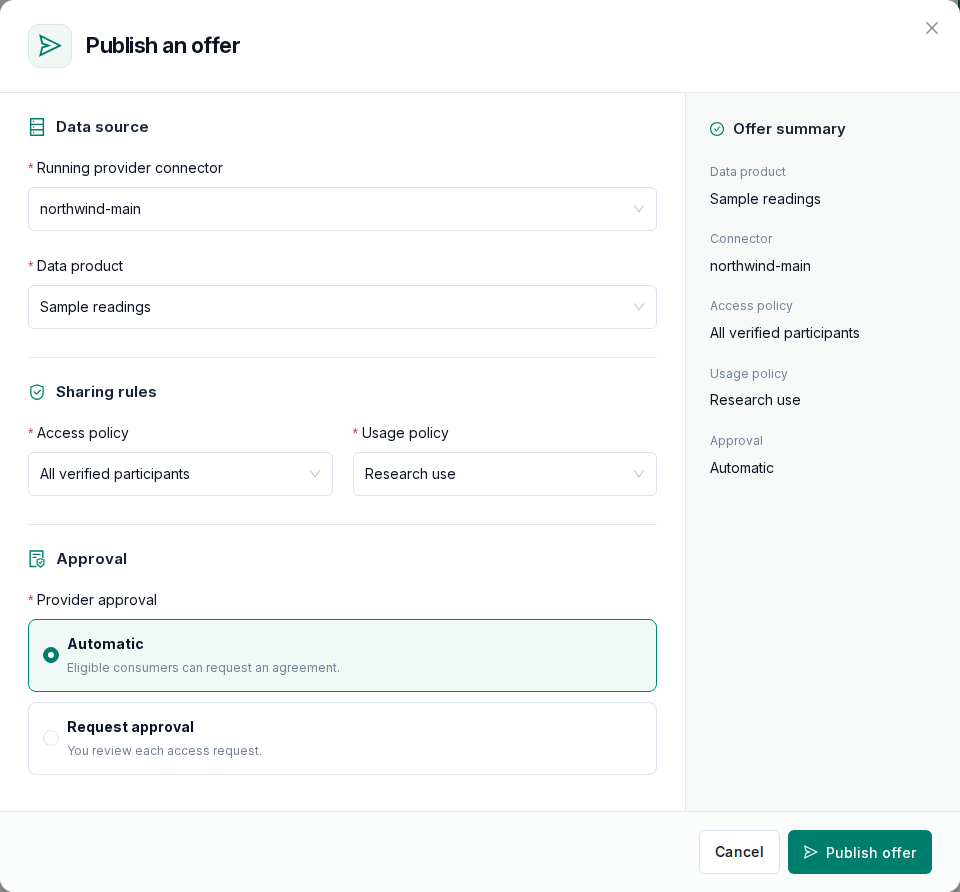
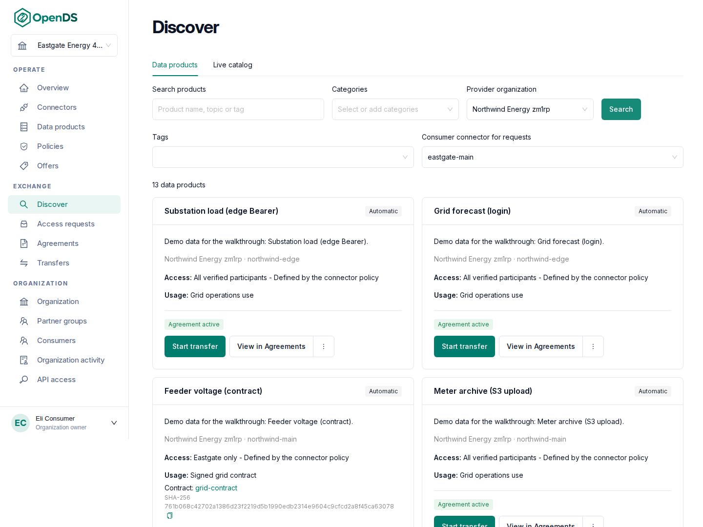
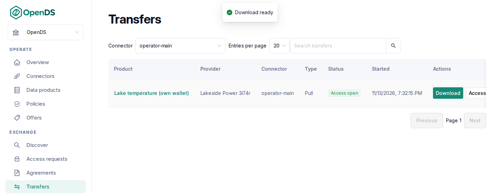

# Your first data exchange

This walk-through takes two organizations from registration to a downloaded file. It takes
about half an hour, plus the time the connectors need to start. One organization provides the data and the
other consumes it. You need an OpenDS [installation](/getting-started/installation). As data, you
can use the sample that every installation serves at `https://<your domain>/api/test-data`.

## 1. Register both organizations

Open the OpenDS address and select **Register an organization**. Register the provider with
the organization name, your name, email address and password, roles such as **Data
provider**, and the identity type **Test**. Accept the participation terms and submit the
registration. Then register the consumer in the same way, using another browser profile so that you can stay
signed in to both.

As the platform administrator, approve both organizations under **Platform Admin → Organizations
awaiting approval**. A few seconds later, the **Organization** page of each organization shows
its identity as **Ready**.

## 2. Start a connector for each organization

In each organization, open **Connectors → New connector**, enter a name and save. Then select
**Provision** on the connector page. The connector shows **Running** after a few minutes. The
first connector of an installation takes longer because the software is downloaded first.
Finally, select **List in discovery** on the provider's connector so that other organizations
can find its offers.

## 3. Describe the data and its rules (provider)

1. Under **Policies → New access policy**, create a policy named "All verified participants"
   for the connector and keep the default rule, which allows every verified organization to
   negotiate.
2. Under **Policies → Usage policies → New usage policy**, create a policy for the connector
   with the rule **Allowed usage purposes** and choose a purpose. Consumers accept these terms
   as part of the agreement.
3. Under **Data products → New data product**, enter a name, a description, the connector, a
   category and `https://<your domain>/api/test-data` as the **Provider source URL**. When you
   later offer your own data, use an address that the connector can reach rather than
   `localhost`.

## 4. Publish the offer (provider)

Under **Offers → Publish offer**, choose the connector, the data product, the access policy and
the usage policy. Keep **Automatic** approval and publish the offer. The summary on the right
shows what partners will see.

## 5. Find the offer and agree (consumer)

Under **Discover**, choose your connector under **Consumer connector for requests** and the
provider under **Provider organization**, then select **Search**. The offer appears as a card
together with its policies. Select **Request agreement**. After a few seconds, the agreement
appears under **Agreements** with the status **Agreed**.

## 6. Get the data (consumer)

On the agreement, select **Start transfer**, choose **Pull** and start the transfer. Then select
**Download** under **Transfers**. The file is delivered directly from the provider's
connector.

## What next

- [Publish data](/user-guide/publish-data) and [Cloud storage](/user-guide/cloud-storage) explain how to
  protect a source with a password or token and how to offer files from Amazon S3 or Azure.
- [Publish data](/user-guide/publish-data) also explains how to limit an offer to chosen partners or
  review each request yourself.
- [Discover and exchange data](/user-guide/discover-and-exchange-data) explains how to receive data into your own
  storage or download it repeatedly from a script.
- To exchange real data, move to a managed or self-hosted identity as described under
  [Identity](/user-guide/identity).
