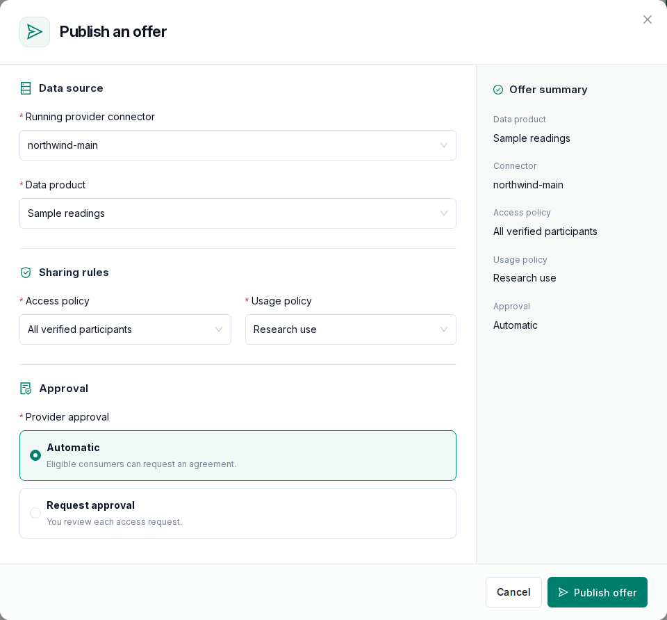
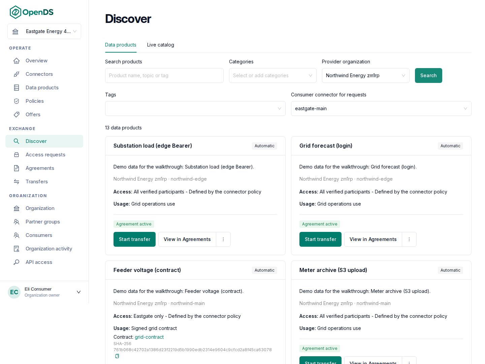
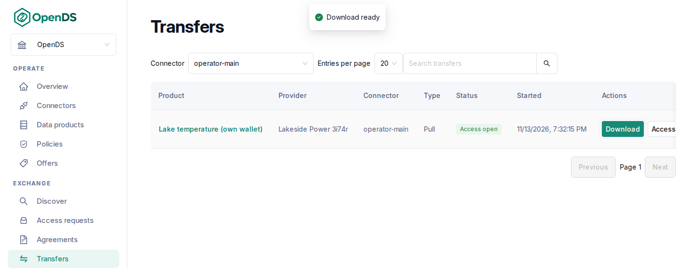

# Your first data exchange

This walk-through takes two organizations from registration to a downloaded file in about
half an hour once the connectors run. One provides data, the other consumes it. You need an
OpenDS installation ([Installation](/getting-started)). As data, use the sample every
installation serves at `https://<your domain>/api/test-data`.

## 1. Register both organizations

Open the OpenDS address, select **Register an organization**, and register the provider: organization name,
your name, email and password, roles such as **Data provider**, and the identity type
**Test**. Accept the participation terms and submit. Do the same for the consumer, in
another browser profile.

A platform administrator approves both under **Platform Admin → Organizations awaiting
approval**. A few seconds later each **Organization** page shows the identity as **Ready**.

## 2. Start a connector for each

As each organization, open **Connectors → New connector**, give it a name and save. On the
connector page select **Provision**. It shows **Running** after a few minutes; the first
connector of an installation takes longer while the software downloads. Then select
**List in discovery** on the provider's connector so others find its offers.

## 3. Describe the data and its rules (provider)

1. **Policies → New access policy**: name it "All verified participants", choose the
   connector and keep the default rule. This lets every verified organization negotiate.
2. **Policies → Usage policies → New usage policy**: name it, choose the connector, the rule
   **Allowed usage purposes** and a purpose. Consumers accept these terms in the agreement.
3. **Data products → New data product**: a name, a description, the connector, a category
   and the **Provider source URL**: `https://<your domain>/api/test-data`. For your own data
   later, use an address the connector can reach, not `localhost`.

## 4. Publish the offer (provider)

**Offers → Publish offer**: choose the connector, the data product, the access policy and the
usage policy, keep **Automatic** approval, and publish.

The summary on the right shows what partners will see.

## 5. Find it and agree (consumer)

**Discover**: choose your connector under **Consumer connector for requests**, the provider
under **Provider organization**, and select **Search**. The offer appears as a card with its
policies. Select **Request agreement**. Under **Agreements** it shows **Agreed** after a few
seconds.

## 6. Get the data (consumer)

On the agreement, select **Start transfer**, choose **Pull** and start it. Under
**Transfers**, select **Download**: the file comes straight from the provider's connector.

## What next

- Protect a source with a password or token, or offer files from Amazon S3 or Azure:
  [Publish data](/guide/publish) and [Cloud storage](/guide/cloud-storage).
- Limit an offer to chosen partners, or review each request yourself:
  [Publish data](/guide/publish).
- Receive data into your own storage, or download repeatedly from a script:
  [Discover and exchange](/guide/exchange).
- Exchange real data: move to a managed or self-hosted identity ([Identity](/guide/identity)).
