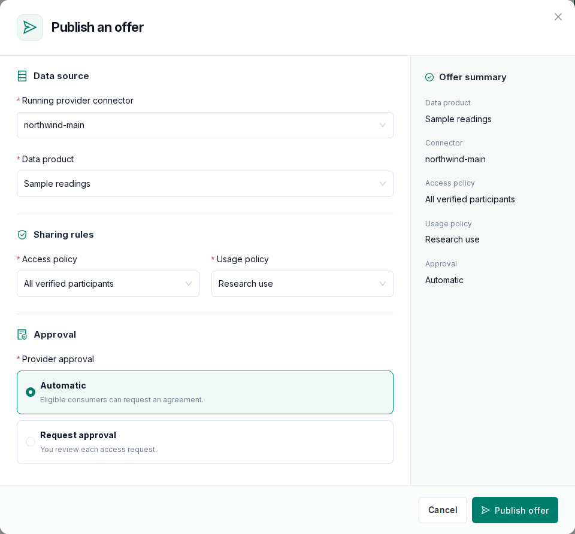

# Publish data

Providers describe data as a product, decide who may use it and on what terms, and publish it
as an offer.

```text
Data product + Access policy + Usage policy -> Offer
```

Products, policies and offers are stored on the connector. Select a running connector when
creating them.

## Data products

Under **Data products** add a product of one of these kinds:

| Kind                | Source                                                                            |
| ------------------- | --------------------------------------------------------------------------------- |
| HTTP                | A URL the connector fetches                                                       |
| Login-protected HTTP | A URL that needs a login; the connector logs in and refreshes the token itself   |
| Amazon S3           | An object in a bucket the connector can read                                      |
| Azure Blob          | A blob in a container the connector can read                                      |
| File upload         | A file stored in the connector's cloud storage                                    |

Give each product a name, a description, categories and tags so consumers can find it. Cloud
storage setup and limits are on the [Cloud storage](/guide/cloud-storage) page.

### Login-protected sources

- The login is configured in the product form: login URL and method, token extraction,
  outgoing headers and token lifetime.
- The login request body with the credentials is entered when the offer is published, or on
  the connector's own server for self-hosted connectors.
- A worker next to the connector logs in and refreshes the token before it expires, and for
  self-hosted connectors the agent does this.
- The login details stay on the connector and are never stored in OpenDS.
- A login service on a private network needs an explicit allowance from the operator
  ([Configuration](/administration/configuration#private-networks)).

## Policies

Under **Policies** create two kinds:

- **Access policy**: who can agree to the offer and see it in a connector's live catalog. Choose
  verified participants only, selected organizations or a **partner group**. Listed offers
  appear under **Discover** for eligible organizations.
- **Usage policy**: the terms of use. Options include time limits, usage purposes, a contract
  reference and an attached contract document, jurisdictions, onward sharing and deletion.
  Upload the contract as a PDF; partners download it from the offer in Discover before they
  agree, and the connector policy carries its SHA-256 so both sides can check the file.

Every term shows who enforces it:

| Enforcement | Terms                                                                      |
| ----------- | -------------------------------------------------------------------------- |
| Connector   | Verified participants, allowed organizations, partner groups, time limits  |
| Contractual | Usage purpose, contract reference, jurisdictions, onward sharing, deletion |

Contractual terms are recorded in the agreement. They are not technically enforced: data a
consumer has received cannot be controlled. See
[Architecture](/architecture#policy-enforcement).

**Partner groups** let you change who is allowed without republishing. Changes are synchronized
to published offers on the configured health-check schedule. Removing a member stops new
agreements after that synchronization; an existing agreement stays valid until you revoke it.
A group that active offers use cannot be renamed or deleted; withdraw those offers first.

## Offers

Under **Offers** publish one product per offer with an access policy and a usage policy.
Partners find the offer under **Discover** once its connector is listed (**List in discovery**
on the connector page).



- **Provider approval**: leave it off so eligible consumers can request an agreement directly,
  or turn it on so you review each access request first. Approval applies to requests made
  through OpenDS; the access policy decides who the connector itself lets negotiate, so use it
  to restrict which organizations are eligible.
- **Withdraw** an offer to stop new discovery and approval requests. Existing exchange history
  stays. Withdraw active offers before changing or deleting their product or policy.

Policies created outside OpenDS are shown read-only. Offers that have no OpenDS approval setting
must be republished before consumers can use the negotiation shortcut.
