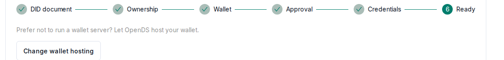

# Self-hosted wallet

This guide applies when your organization chooses **Self-hosted identity**. The wallet runs on
your server and provides your organization with its own `did:web` identity. Its private key
never leaves your server. OpenDS receives only the public key, proof of ownership and the STS
secret used by your connectors. The available identity types and the implications of changing
them are described under [Identity](/user-guide/identity).

## Requirements

- A Linux server with Docker Engine and Docker Compose v2.
- A lowercase DNS name for the wallet, such as `wallet.example.org`, that points to the
  server. For a short test, an address-based `sslip.io` name can be used instead.
- Inbound TCP port 443, which the wallet also uses to obtain its certificate.
- An OpenDS organization configured for **Self-hosted identity**.
- For a private network, the dataspace operator must allow the wallet's address with
  `ORGANIZATION_PRIVATE_NETWORKS`, as described under
  [Private networks](/administration/configuration#private-networks). By default, OpenDS
  connects only to public addresses.

## Starting the wallet

Download the wallet bundle from **Organization → Dataspace identity**. The bundle is configured
for your dataspace and includes its CA certificate when the dataspace uses a private CA. Keep
the extracted directory private, because setup writes secrets to its `.env` file.

If this server also runs your connectors or already has a reverse proxy, read the two sections
below before running setup. Otherwise, on the wallet server, extract the bundle, open its
directory, then run:

```bash
./wallet.sh setup wallet.example.org
```

Replace `wallet.example.org` with your wallet's DNS name. Then start the wallet:

```bash
sudo ./wallet.sh start
```

To follow the IdentityHub startup logs, run:

```bash
sudo docker compose logs -f identityhub
```

Wait until the logs indicate that the runtime is ready. Do not share the generated `.env` file
or add it to source control.

### Sharing one HTTPS entry with connectors

If this server also runs your self-hosted connectors, add `--shared-edge` when setting up the
wallet:

```bash
./wallet.sh setup wallet.example.org --shared-edge
```

Start the connectors with `CONNECTOR_EDGE=shared`, so that the wallet and the connectors share
one HTTPS entry on TCP port 443. Stopping the wallet removes it from that shared entry.

### Using an existing reverse proxy

If nginx or Traefik already terminates HTTPS for this server, use `--external-proxy` instead of
`--shared-edge`:

```bash
./wallet.sh setup wallet.example.org --external-proxy 127.0.0.1:9443
sudo ./wallet.sh start
```

If the proxy runs on another host, use the wallet server's private address in
`--external-proxy` instead of `127.0.0.1`, and add `--proxy-allow <proxy-address>`. After
startup, add either `external-proxy/nginx.conf` or `external-proxy/traefik.yml` to your proxy
configuration and provide a certificate for the wallet domain.

Only the DID document, the credential service and the STS are public. The management API must
remain private and must never be exposed through the proxy.

## Connecting the wallet to OpenDS

In OpenDS, open **Organization → Dataspace identity** and complete the displayed steps. Keep
the page open while completing the first two steps, because the ownership challenge is
generated together with the DID document and is not displayed again after the page is
reloaded.

1. **DID document**: run `./wallet.sh public-key` and paste the public key into OpenDS. It is
   the line that begins with `{"kty"`. The first run may also print Docker download messages,
   which you must not paste. Enter the credential-service endpoint, replacing the domain with
   your wallet's domain:

   ```text
   https://wallet.example.org/api/credentials/v1/participants/did:web:wallet.example.org
   ```

   Download the generated `did.json` and save it as `./did/did.json` in the wallet directory.
   The wallet then publishes it at `https://wallet.example.org/.well-known/did.json`.
2. **Ownership**: sign the challenge displayed by OpenDS and paste the result:

   ```bash
   ./wallet.sh sign '<challenge>'
   ```

3. **Wallet**: enter the STS URL `https://wallet.example.org/api/sts/token`, the same
   credential-service endpoint, and the secret printed by:

   ```bash
   ./wallet.sh secret
   ```

4. **Approval**: OpenDS shows **Waiting for a platform administrator**. A platform
   administrator confirms that the domain belongs to your organization and approves the
   identity under **Platform Admin → Production identities awaiting approval**. This is
   separate from the earlier approval of the organization.
5. **Credentials**: after approval, request credentials using the issuer DID displayed by
   OpenDS:

   ```bash
   ./wallet.sh request-credentials '<issuer-DID>'
   ./wallet.sh status
   ```

   OpenDS marks the identity as ready once all required credentials are issued.

   

After you add connectors, the **Organization** page lists their entries under "Add these
connector entries to the `service` list", including their `id`, `type` and `serviceEndpoint`.
Add each entry manually to the `service` array in `./did/did.json`. Remove the entries of
deleted connectors, so that other participants can discover the current connectors.

## Operation and backup

- **Start and stop**: `sudo ./wallet.sh start` and `sudo ./wallet.sh stop`. After a server
  restart, run `start` again. It also unseals the wallet's Vault.
- **STS secret**: rotate it with `./wallet.sh rotate-secret`, as described under
  [Identity](/user-guide/identity#rotating-the-sts-secret).
- **Backup**: back up the `vault`, `vault-keys` and `postgres` Docker volumes together, because
  losing them means losing the wallet's private keys.
