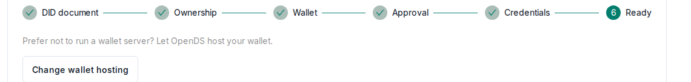

# Self-hosted wallet

This guide applies when your organization chooses **Self-hosted identity**. The wallet runs on
your server and gives your organization its own `did:web` identity. Its private key never leaves
that server. OpenDS only receives the public key, proof that you control it, and the
STS secret that your connectors use. The identity types and the effects of changing them are
described under [Identity](/user-guide/identity).

## Requirements

- A Linux server with Docker Engine and Docker Compose v2.
- A lowercase DNS name for the wallet, such as `wallet.example.org`, that points to the
  server. For a short test, an address-based `sslip.io` name can be used instead.
- Inbound TCP port 443, which the wallet also uses to obtain its certificate.
- An OpenDS organization configured for **Self-hosted identity**.

Download the wallet bundle from **Organization → Dataspace identity**. The bundle is configured
for your dataspace and includes its CA certificate when the dataspace uses a private CA. Keep
the extracted directory private, because setup writes secrets to its `.env` file.

## Starting the wallet

On the wallet server, extract the bundle, open its directory, then run:

```bash
./wallet.sh setup wallet.example.org
sudo ./wallet.sh start
sudo docker compose logs -f identityhub
```

Replace `wallet.example.org` with your wallet's DNS name and wait until the IdentityHub log
reports that the runtime is ready. The generated `.env` file must not be shared or added to
source control.

### Sharing one HTTPS entry with connectors

If this server also runs your self-hosted connectors, add `--shared-edge` when setting up the
wallet:

```bash
./wallet.sh setup wallet.example.org --shared-edge
```

Start the connectors with `CONNECTOR_EDGE=shared`, so that the wallet and the connectors share
one HTTPS entry on TCP port 443. Stopping the wallet removes it from that shared entry.

### Using an existing reverse proxy

If nginx or Traefik already terminates HTTPS for this server, use `--external-proxy` instead of
`--shared-edge`:

```bash
./wallet.sh setup wallet.example.org --external-proxy 127.0.0.1:9443
sudo ./wallet.sh start
```

For a proxy on another host, use the wallet server's private address in `--external-proxy`
instead of `127.0.0.1`, and add
`--proxy-allow <proxy-address>`. After startup, add either `external-proxy/nginx.conf` or
`external-proxy/traefik.yml` to your proxy configuration, and give the proxy a certificate for
the wallet domain. Only the DID document, the credential service and the STS are public. The
management API stays private and must never be published.

## Connecting the wallet to OpenDS

In OpenDS, open **Organization → Dataspace identity** and complete the steps shown there.

1. Under **DID document**, run `./wallet.sh public-key` and paste its output. Enter this
   credential-service endpoint, replacing the domain:

   ```text
   https://wallet.example.org/api/credentials/v1/participants/did:web:wallet.example.org
   ```

   Download the generated `did.json` and save it as `./did/did.json` in the wallet directory.
   The wallet then publishes it at `https://wallet.example.org/.well-known/did.json`.
2. Under **Ownership**, sign the challenge that OpenDS displays and paste the result:

   ```bash
   ./wallet.sh sign '<challenge>'
   ```

3. Under **Wallet**, enter the STS URL
   `https://wallet.example.org/api/sts/token`, the same credential-service endpoint, and the
   secret printed by:

   ```bash
   ./wallet.sh secret
   ```

4. OpenDS shows **Waiting for a platform administrator**. An administrator confirms that the
   domain belongs to your organization and approves the identity under **Platform Admin →
   Production identities awaiting approval**. This is separate from the earlier approval of the
   organization.
5. After approval, request credentials using the issuer DID displayed by OpenDS:

   ```bash
   ./wallet.sh request-credentials '<issuer-DID>'
   ./wallet.sh status
   ```

   OpenDS marks the identity as ready once all required credentials are issued.

   

After you add connectors, OpenDS lists their `DataService` entries. Add them to the `service`
array in `./did/did.json` so that partners can find the connectors.

## Operation and backup

- **Start and stop**: `sudo ./wallet.sh start` and `sudo ./wallet.sh stop`.
- **STS secret**: rotate it with `./wallet.sh rotate-secret`, as described under
  [Identity](/user-guide/identity#rotating-the-sts-secret).
- **Backup**: back up the `vault`, `vault-keys` and `postgres` Docker volumes together, because
  losing them means losing the wallet's private keys.
