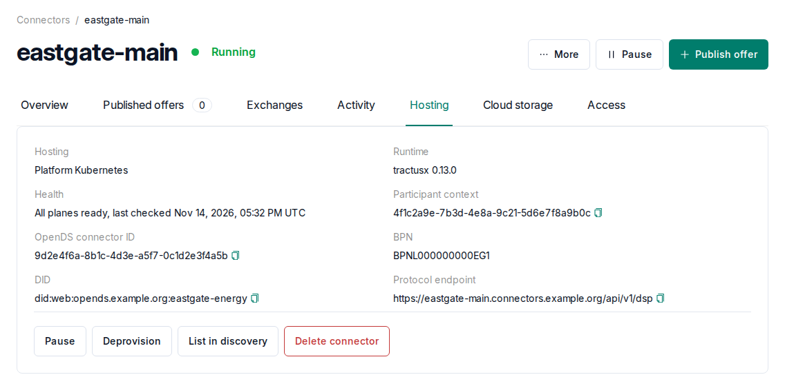

# Connectors

A connector is the software that exchanges data on behalf of your organization. Connectors are
created and managed under **Connectors**.

If your organization has a self-hosted identity, add each new connector to your wallet's
`did.json` so that partners can find it, as described under
[Self-hosted wallet](/self-hosting/self-hosted-wallet#connecting-the-wallet-to-opends).

## Hosting modes

| Mode            | Where it runs                                  | Suitable for                                       |
| --------------- | ---------------------------------------------- | -------------------------------------------------- |
| Platform-hosted | On Kubernetes, managed by the dataspace operator | Organizations that do not want to install anything |
| Self-hosted     | On your organization's own Docker host         | Organizations that operate the connector themselves |

The hosting mode can be changed on the connector page. This is a migration: export the connector
data, set up the connector in the new mode,
import its products and policies, enter the source credentials again and publish the offers
again. Existing agreements cannot be moved, so partners negotiate again.

To self-host a connector, create it, select **Use self-hosting** on its **Hosting** tab and run
the commands shown on your Docker host. Installation, HTTPS options, source credentials and
moving to another server are described under
[Self-hosted connector](/self-hosting/self-hosted-connector).

## Lifecycle

**Provision**, **Pause** and **Resume** are at the top of the connector page. The
**Hosting** tab contains **List in discovery**, **Deprovision**, **Delete connector** and the
self-hosting actions. **Export connector data** is under **More**.

- **Provision**: installs a new platform-hosted connector. This may take several minutes while
  images are downloaded and services start.
- **Pause** and **Resume**: stop and start the connector services while keeping their data. A
  paused connector's offers are hidden from **Discover**.
- **Deprovision**: uninstalls the connector's services. The connector stays in OpenDS and can be
  provisioned again, but its products, policies and offers are lost.
- **List in discovery**: lets other organizations find the connector's offers under
  **Discover**. A connector that is not listed still exchanges data, but partners can only
  reach it with its DSP address and your DID. The connector's **Hosting** tab shows both, as
  **Protocol endpoint** and **DID**, each with a copy button.
- **Export connector data**: saves the connector's data while it is online, to move it or keep
  a copy ([API](/user-guide/api#connector-data-export-and-import)).
- **Delete**: removes the connector and its platform record. Stop a self-hosted connector on its
  host first, because OpenDS cannot erase a remote machine. If you need its products, policies and offers
  later, export them beforehand.

Before a connector is deleted or deprovisioned, the confirmation offers **Download connector
data first**, because OpenDS does not archive connector data itself. A paused or offline
connector must be started first.

Health checks run regularly. The connector page shows their result together with recent
events. Who may perform these actions is listed under [Roles](/user-guide/overview#roles).
