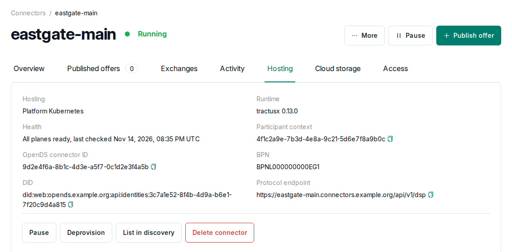

# Connectors

A connector exchanges data on behalf of your organization. You can create and manage
connectors under **Connectors**.

If your organization uses a self-hosted identity, add each new connector to the `did.json`
file in your wallet so that other participants can discover it. See
[Self-hosted wallet](/self-hosting/self-hosted-wallet#connecting-the-wallet-to-opends) for
instructions.

## Hosting modes

| Mode            | Where it runs                                    | Suitable for                                                                 |
| --------------- | ------------------------------------------------ | ---------------------------------------------------------------------------- |
| Platform-hosted | On Kubernetes, managed by the dataspace operator | Organizations that do not want to manage their own connector infrastructure |
| Self-hosted     | On the organization's own Docker host            | Organizations that want to operate their connectors on their own infrastructure |

The hosting mode can be changed on the connector page. This is a migration with five steps:

1. Export the connector data.
2. Set up the connector in the new hosting mode.
3. Import its products and policies.
4. Re-enter the source credentials, if required.
5. Publish the offers again.

Existing agreements cannot be transferred, so other participants must negotiate them again.

To set up a self-hosted connector, create it, select **Use self-hosting** on its **Hosting**
tab and run the commands shown on your Docker host. Installation, HTTPS options, source
credentials and migration to another server are described under
[Self-hosted connector](/self-hosting/self-hosted-connector).

## Lifecycle

**Provision**, **Pause** and **Resume** are available at the top of the connector page. The
**Hosting** tab contains **List in discovery**, **Deprovision**, **Delete connector** and the
self-hosting actions. **Export connector data** is available under **More**.

- **Provision**: installs a new platform-hosted connector. This may take several minutes while
  images are downloaded and services start.
- **Pause** and **Resume**: stop and start the connector services while retaining their data.
  A paused connector's offers are hidden from **Discover**.
- **Deprovision**: uninstalls the connector services. The connector remains in OpenDS and can
  be provisioned again, but its products, policies and offers are lost.
- **List in discovery**: makes the connector's offers discoverable by other organizations
  under **Discover**. A connector that is not listed can still exchange data, but other
  participants need its DSP address and DID to connect to it. Both are available on the
  connector's **Hosting** tab as **Protocol endpoint** and **DID**, with a copy button for
  each.
- **Export connector data**: exports the connector's data while it is online, allowing you to
  move it or keep a backup ([API](/user-guide/api#connector-data-export-and-import)).
- **Delete connector**: removes the connector and its record from OpenDS. Stop a self-hosted
  connector on its host first, as OpenDS cannot remove it from a remote machine. Export its
  data beforehand if you may need its products, policies or offers later.

Before a connector is deleted or deprovisioned, the confirmation dialog offers **Download
connector data first**, as OpenDS does not archive connector data. A paused or offline
connector must be started before its data can be downloaded.

Health checks run regularly. Their results and recent events are displayed on the connector
page. The permissions required to perform these actions are listed under
[Roles](/user-guide/overview#roles).
