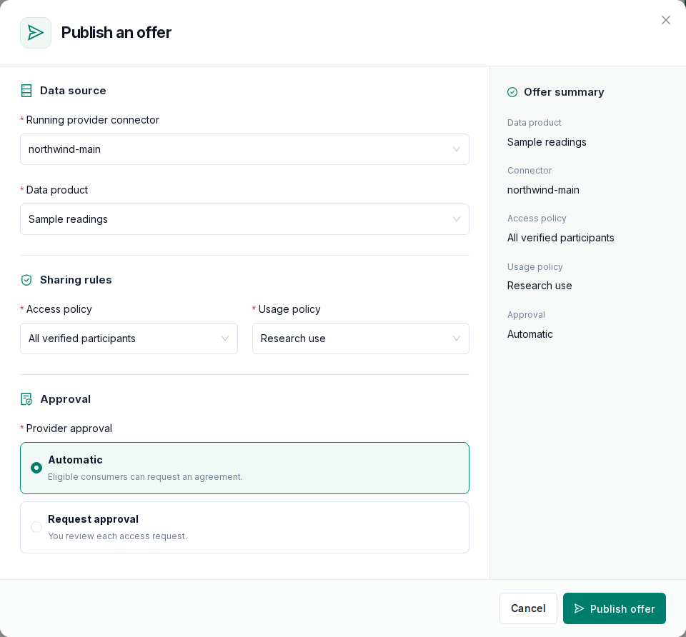

# Publish data

Providers describe their data as a product, decide who may use it and on what terms, and
publish it as an offer.

```text
Data product + Access policy + Usage policy -> Offer
```

Products, policies and offers are stored on the connector, so select a running connector
before creating them.

## Data products

Under **Data products**, add a product and choose its **Source type**:

| Source type          | Source                                            |
| -------------------- | ------------------------------------------------- |
| HTTP API or file URL | A URL that the connector fetches                  |
| Amazon S3            | An object in a bucket that the connector can read |
| Azure Blob Storage   | A blob in a container that the connector can read |

For Amazon S3 and Azure Blob Storage, you can choose an existing file or upload a new one.
These source types appear only when the connector has cloud storage set up, as described under
[Cloud storage](/user-guide/cloud-storage).

Give each product a name, a description, categories and tags so that consumers can find it.

### Protected HTTP sources

If an HTTP source requires authentication, choose the type under **HTTP source
authentication**:

- None
- Bearer token
- Username and password (Basic)
- API key in a header
- Custom header
- Login endpoint that returns a token. The connector logs in and renews the token itself.

The settings and the secret are entered in two places:

- **On the product**: the authentication type and, depending on it, the username or the header
  name. For a login endpoint, the product form also takes the login URL and method, token
  extraction, outgoing headers and token lifetime.
- **When you publish the offer**: the secret itself, such as the token, the password or the
  login request body. For self-hosted connectors, it is entered on the connector's own server
  ([Self-hosted connector](/self-hosting/self-hosted-connector#source-passwords-and-cloud-keys)).

The credentials stay on the connector and are never stored in OpenDS. For a platform-hosted
connector, a login service on a private network must first be allowed by the dataspace operator
([Configuration](/administration/configuration#private-networks)).

## Policies

Under **Policies**, create two kinds of policies:

- **Access policy**: decides who can see the offer in a connector's catalog and agree to it.
  You can allow all verified participants, selected organizations or a **partner group**.
- **Usage policy**: defines the terms of use, such as time limits, usage purposes, a contract
  reference with an attached contract document, jurisdictions, onward sharing and deletion.
  Partners download the contract PDF from the offer in **Discover** before they agree, and a
  checksum lets both sides verify the file. The platform administrator defines the list of usage
  purposes for the whole dataspace, and you choose from it.

Some terms are enforced by the connector. Others are contractual and recorded in the
agreement, because data that a consumer has already received cannot be technically controlled.
[Policy enforcement](/architecture#policy-enforcement) shows which terms belong to which group.

**Partner groups** let you change who is allowed without republishing: changes to a group also
apply to offers that are already published. Owners and administrators create them under
**Partner groups** in the sidebar. Removing a member prevents new agreements, but an
existing agreement stays valid until you revoke it. A group used by active offers cannot be
renamed or deleted until those offers are withdrawn.

Policies created outside OpenDS are shown read-only.

## Offers

Under **Offers**, publish one product per offer with an access policy and a usage policy.
Partners find the offer under **Discover** once its connector is listed with
**List in discovery** on the connector's **Hosting** tab.



- **Provider approval**: with **Automatic**, eligible consumers can request an agreement
  directly. With **Request approval**, you review each access request first. Approval is a step
  in OpenDS and does not stop a partner who contacts your connector directly, so use the access
  policy to restrict which organizations are eligible.
- **Withdraw**: removes the offer from **Discover** and stops new access requests. Existing exchange history is kept.
  Active offers must be withdrawn before their product or policy can be changed or deleted.
