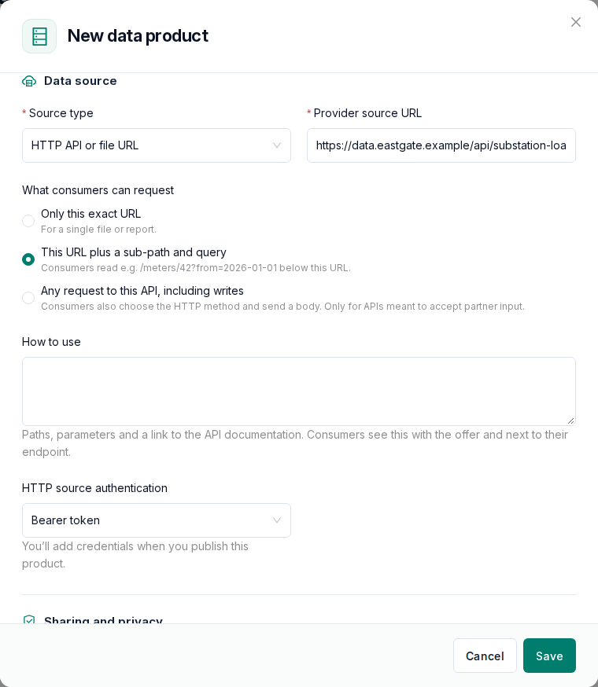
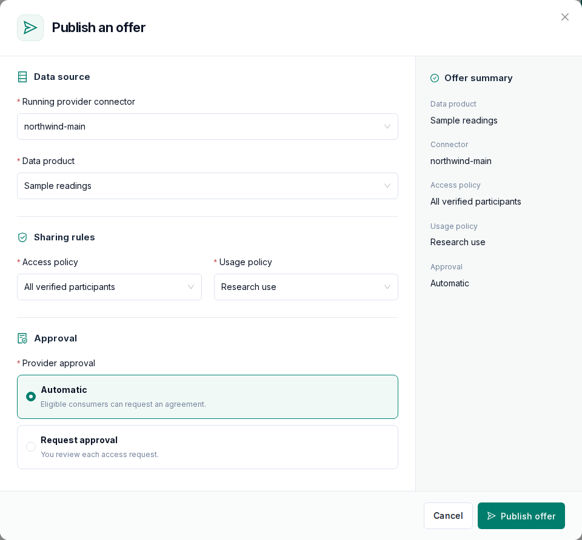

# Publish data

Providers describe their data as a product, define who can access it and under what terms, and
publish it as an offer.

```text
Data product + Access policy + Usage policy -> Offer
```

Products, policies and offers are stored on the connector. Select a running connector before
creating them.

## Data products

Under **Data products**, create a product and select its **Source type**:

| Source type          | Source                                            |
| -------------------- | ------------------------------------------------- |
| HTTP API or file URL | A URL that the connector fetches                  |
| Amazon S3            | An object in a bucket that the connector can read |
| Azure Blob Storage   | A blob in a container that the connector can read |

For Amazon S3 and Azure Blob Storage, you can select an existing file or upload a new one.
These source types are available only when cloud storage is configured for the connector, as
described under [Cloud storage](/user-guide/cloud-storage).

Give each product a name, description, categories and tags to help consumers find it. Two
additional options describe the data:

- **This data contains personal information**: helps consumers identify products containing
  sensitive data. Access and usage restrictions are defined separately through the offer's
  policies.
- **Show a sample in Discover**: makes the sample content you provide visible to everyone
  browsing **Discover**, before they agree to the usage terms.

### HTTP sources

The **Provider source URL** must be reachable over the network from the connector. `localhost`
does not work, because the connector runs in its own container and would look for the service
inside that container.

Two additional fields define how consumers can use an HTTP source:

- **What consumers can request**:
  - **Only this exact URL**: for a single file or report.
  - **This URL plus a sub-path and query** (the default): consumers can request resources below
    the specified URL, for example `/meters/42?from=2026-01-01`.
  - **Any request to this API, including writes**: consumers can choose the HTTP method and
    send a request body. Use this only for APIs intended to accept requests from other
    participants.
- **How to use**: free text describing paths and parameters, with an optional link to the API
  documentation. Consumers see this information with the offer and next to their endpoint.

### Protected HTTP sources

If an HTTP source requires authentication, select the authentication type under **HTTP source
authentication**:

- None
- Bearer token
- Username and password (Basic)
- API key in a header
- Custom header
- Login endpoint that returns a token. The connector handles login and token renewal
  automatically.

Authentication settings and secrets are entered separately:

- **On the product**: the authentication type and, depending on the type, the username or
  header name. For a login endpoint, the product form also includes the login URL and method,
  token extraction settings, outgoing headers and token lifetime.
- **When publishing the offer**: the secret itself, such as the token, the password or the
  login request body. For self-hosted connectors, enter it on the connector's own server
  ([Self-hosted connector](/self-hosting/self-hosted-connector#source-passwords-and-cloud-keys)).



Credentials remain on the connector and are never stored in OpenDS. For platform-hosted
connectors, a login service on a private network must first be allowed by the dataspace
operator ([Configuration](/administration/configuration#private-networks)).

## Policies

Under **Policies**, create two kinds of policies:

- **Access policy**: determines who can see the offer in a connector's catalog and request an
  agreement. You can allow all verified participants, selected organizations or a **partner
  group**.
- **Usage policy**: defines the terms of use, such as time limits, usage purposes, a contract
  reference with an attached contract document, jurisdictions, onward sharing and deletion.
  Other participants can download the contract PDF from the offer in **Discover** before
  agreeing. A checksum allows both sides to verify the file. The platform administrator defines
  the usage purposes available across the dataspace, and you select from that list.

The connector enforces some terms technically. Others are contractual and recorded in the
agreement, because data that a consumer has already received cannot be technically controlled.
[Policy enforcement](/architecture#policy-enforcement) shows which terms belong to which group.

**Partner groups** let you change who is allowed without republishing offers. Changes to a
group also apply to offers that are already published. Organization owners and administrators
can create and manage groups under **Partner groups** in the sidebar. Removing an organization
from a group prevents new agreements, but an existing agreement stays valid until you revoke
it. A group used by active offers cannot be renamed or deleted until those offers are
withdrawn.

Policies created outside OpenDS are shown read-only.

## Offers

Under **Offers**, publish one product per offer with an access policy and a usage policy.
Other participants can find the offer under **Discover** once the connector is listed with
**List in discovery** on its **Hosting** tab.



- **Provider approval**: with **Automatic**, eligible consumers can request an agreement
  directly. With **Request approval**, you review each access request before it proceeds. This
  approval step applies within OpenDS and does not prevent participants from contacting your
  connector directly, so use the access policy to restrict which organizations are eligible.
- **Withdraw**: removes the offer from **Discover** and prevents new access requests. Existing
  exchange history is retained. Active offers must be withdrawn before their product or policy
  can be changed or deleted.
